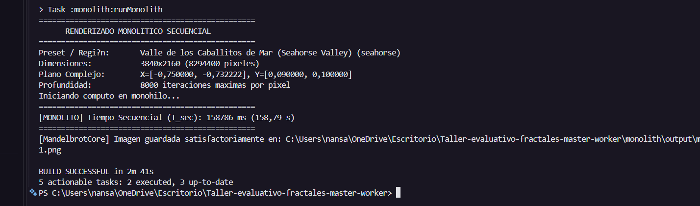
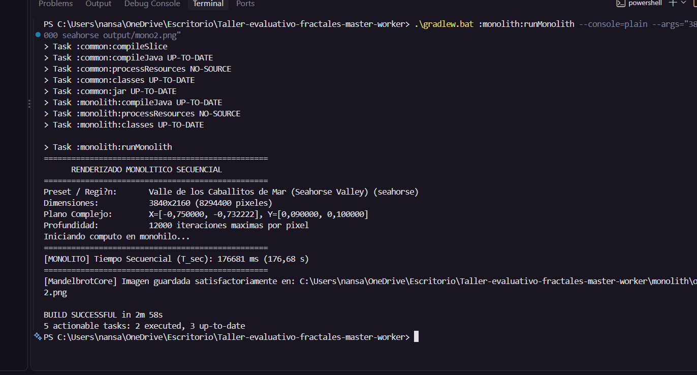
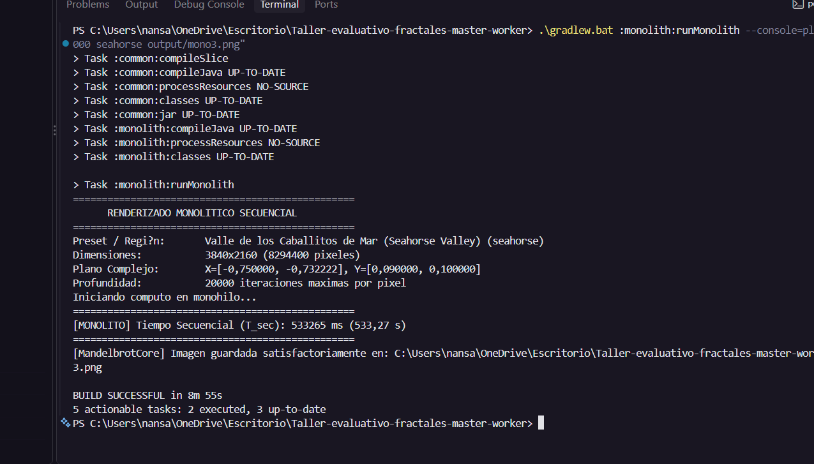
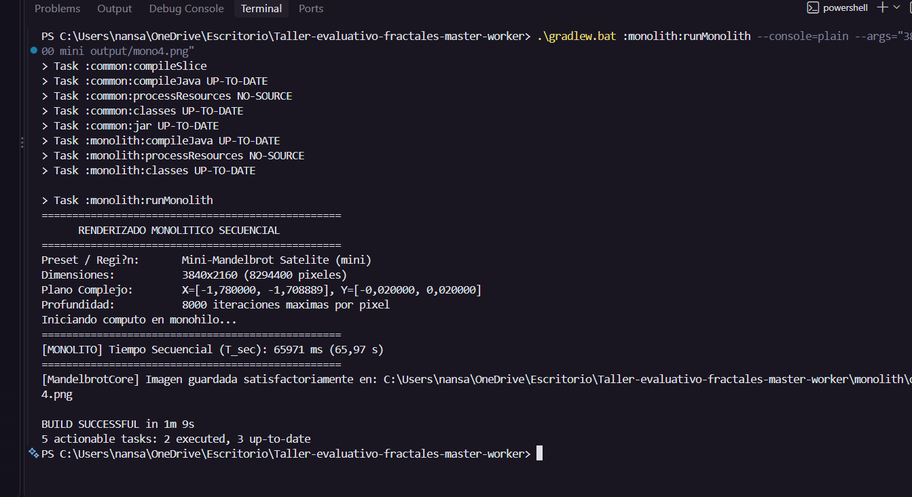
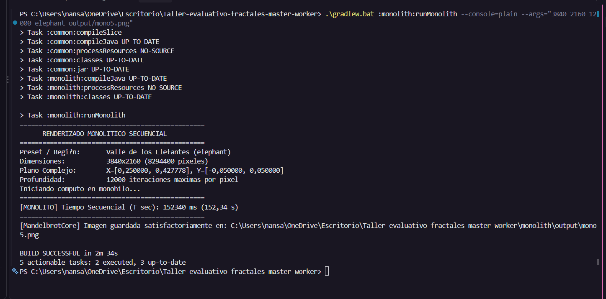

# Informe del taller de fractales

### Tablas (Exp 1, 2 y 3)

## Fase individual: monolito secuencial (Persona B)

**Equipo de pruebas:** Intel Core i7-13620H (10 núcleos físicos, 16 lógicos), 16 GB de RAM instalada (15,73 GiB detectados), Windows 11 Home Single Language. Especificaciones consultadas en el equipo desde el que se tomaron las capturas; no se adjuntó `00-specs.png`.

**Software:** JDK 21, Gradle 8.6, ZeroC Ice (compilador `slice2java` 3.7.11; runtime `com.zeroc:ice:3.7.10`).

**Método:** una corrida por configuración, en monohilo y sin otros programas pesados abiertos. Se transcribe `T_sec` tal como aparece en cada captura, medido por `[MONOLITO] Tiempo Secuencial`; no se confunde con la duración total de Gradle.

**Calibración previa:** seahorse, 1280x720, 2000 iteraciones: `T_sec = 2913 ms`. Se usó para estimar por escalado de píxeles × iteraciones qué parámetros podían quedar entre 1 y 10 minutos.

| # | Región | Resolución | maxIter | T_sec (ms) | T_sec (min) | Evidencia |
|---|--------|-----------|---------|-----------:|------------:|-----------|
| 1 | seahorse | 3840x2160 | 8000 | 158786 | 2,65 |  |
| 2 | seahorse | 3840x2160 | 12000 | 176681 | 2,94 |  |
| 3 | seahorse | 3840x2160 | 20000 | 533265 | 8,89 |  |
| 4 | mini | 3840x2160 | 8000 | 65971 | 1,10 |  |
| 5 | elephant | 3840x2160 | 12000 | 152340 | 2,54 |  |

Las cinco configuraciones y parámetros coinciden con las capturas. Todas las mediciones quedaron dentro del intervalo objetivo de 1 a 10 minutos.

**Observaciones:** la corrida más pesada fue seahorse a 20000 iteraciones, con 533265 ms (8,89 min). En seahorse, aumentar maxIter de 8000 a 12000 elevó el tiempo de 158786 a 176681 ms; al subir a 20000, llegó a 533265 ms, por lo que el tiempo no escala de forma estrictamente lineal. A 12000 iteraciones, elephant tardó 152340 ms, menos que seahorse; mini tardó 65971 ms con 8000 iteraciones. La comparación evidencia que el tiempo depende tanto del límite de iteraciones como de la distribución de píxeles y del comportamiento de escape de cada región.

### Gráficos (Experimentos 1, 2 y 3)

Este bloque contiene los resultados individuales de Persona B. Los gráficos comparativos de los experimentos grupales 1, 2 y 3 no forman parte de las evidencias recibidas para esta sección.

### Cuestionario

Las respuestas del cuestionario de análisis corresponden al informe grupal; no se incluyen en las instrucciones ni en las evidencias de la sección individual de Persona B.

## Bitácora de uso ético de IAG (Nivel 3: Colaboración Asistida)

### 1. Herramientas utilizadas

- **Claude (Anthropic), chat web/móvil:** análisis del enunciado y del código base, planificación del trabajo, diagnóstico de errores de entorno e instrucciones para preparar secciones del informe.
- **GitHub Copilot, modo agente en Visual Studio:** aplicación del cambio de código solicitado, comandos de Git y Gradle, configuración del entorno y apoyo para organizar las evidencias y redactar este registro.

### 2. Registro cronológico de interacciones (16 de octubre de 2026)

| # | Herramienta | Qué se pidió (resumen) | Asistencia recibida | Qué hizo el estudiante con ella |
|---|-------------|------------------------|---------------------|---------------------------------|
| 1 | Claude | Analizar el enunciado de Canvas y el repositorio; proponer el uso de ZeroTier y un plan para dos personas. | Revisión del PDF y del código; plan de trabajo por bloques y roles de Persona A y Persona B. | Adoptó el rol de Persona B y coordinó la distribución del trabajo con su compañera. |
| 2 | Claude | Revisar el código del worker. | Identificó que `WorkerMain` registraba el observer en `127.0.0.1`, inadecuado entre máquinas, y propuso un argumento opcional `workerHost`. | Revisó el cambio y su propósito para permitir que el Master contacte al worker en otra máquina. |
| 3 | Claude | Explicar cómo configurar ZeroTier desde cero. | Instrucciones para crear/unirse a una red, autorizar dispositivos, revisar reglas de firewall y probar conectividad. | Creó la red `icesi-parche`, autorizó el dispositivo y compartió el Network ID con su compañera. |
| 4 | Claude → Copilot | Preparar instrucciones para aplicar el cambio en `main` sin mezclar el trabajo de la Persona A. | Reglas de Git y alcance limitado al archivo `WorkerMain.java`. | Revisó el commit `b933f86`: `git show --stat` confirma que modifica únicamente `worker/src/main/java/co/icesi/fractal/worker/WorkerMain.java`. El commit se publicó en `main` y se creó `feat/zerotier`. |
| 5 | Claude / Copilot | Resolver errores al usar Gradle con una JVM incompatible. | Recomendación de JDK 21 con el wrapper Gradle 8.6. | Instaló JDK 21 y verificó que Gradle 8.6 se ejecuta con esa JVM. |
| 6 | Claude / Copilot | Resolver el error `slice2java.exe not found`. | Diagnóstico de la dependencia ZeroC Ice y configuración de `ICE_HOME` y `PATH`. | Instaló Ice 3.7.11; `slice2java -v` y `.\gradlew.bat build` terminaron correctamente. El compilador 3.7.11 y el runtime `com.zeroc:ice:3.7.10` tienen versiones menores distintas; la compilación se completó. |
| 7 | Claude | Preparar instrucciones de conexión para la Persona A y diagnosticar su acceso a ZeroTier. | Mensaje para la compañera, estados posibles de la red y sugerencia de prueba local del clúster. | La prueba de humo del clúster todavía no se ha realizado. **AGREGAR LUEGO:** confirmar registro de workers y coincidencia del resultado con el monolito. |
| 8 | Claude | Explicar cómo ejecutar las corridas del monolito y qué evidencias guardar. | Procedimiento de calibración, comandos y cinco nombres para las capturas. | Ejecutó las cinco configuraciones y aportó capturas con los valores `T_sec` del programa; los tiempos de la tabla se transcribieron de esa evidencia. |
| 9 | Claude / Copilot | Ajustar y revisar las cinco configuraciones con base en la calibración de 2913 ms. | Parámetros para seahorse, mini y elephant a 3840x2160. | Las capturas confirman las cinco configuraciones especificadas y que sus tiempos se encuentran entre 1 y 10 minutos. |
| 10 | Claude | Redactar las secciones de monolito secuencial y bitácora de IAG. | Borrador de ambas secciones e indicaciones para resolver campos pendientes. | Contrastó la información con las capturas, el repositorio y el historial de cambios; queda pendiente añadir el resultado de la prueba de humo. |
| 11 | Copilot | Integrar las capturas proporcionadas y completar el informe con sus datos. | Normalizó los nombres de archivo a una sola extensión `.png`, transcribió `T_sec` y completó las tablas y la bitácora en `docs/INFORME.md`. | Aportó las cinco capturas y solicitó incorporarlas al informe. |

### 3. Código incorporado y justificación crítica

**Único cambio de código fuente generado con asistencia de IA:** `worker/src/main/java/co/icesi/fractal/worker/WorkerMain.java` (commit `b933f86` en `main`).

- **Problema:** el worker construía el proxy del observer con `tcp -h 127.0.0.1`. Al registrarlo en el Master, este recibía un proxy que apuntaba a su propio localhost; por ello, `notifyTasksAvailable` podía fallar cuando Master y Worker corrían en máquinas distintas.
- **Solución:** se agregó el campo `workerHost` y un sexto argumento opcional (`<puerto> <workerId> <masterHost> <masterPort> <hilos> [workerHost]`). Si se omite, el valor por defecto sigue siendo `127.0.0.1`, por lo que la ejecución local conserva su comportamiento.
- **Validación:** `.\gradlew.bat build` terminó con `BUILD SUCCESSFUL` usando Java 21, Gradle 8.6 e Ice 3.7.11. **AGREGAR LUEGO:** resultado de la prueba de humo; aún no se ha ejecutado.
- **Justificación:** el host anunciado por el proxy debe ser alcanzable desde el Master, no asumirse como localhost. Hacerlo configurable habilita el despliegue multi-máquina y conserva el valor local por defecto; limitar el cambio a `WorkerMain.java` evita alterar módulos o configuraciones no relacionados.

**Cambios de entorno (no son código del proyecto):** JDK 21 como JVM de Gradle, instalación de ZeroC Ice 3.7.11 y configuración de `ICE_HOME`.

### 4. Qué no se delegó a la IA

- Las cinco ejecuciones experimentales y sus mediciones fueron realizadas por el equipo; la bitácora transcribe los valores visibles en las capturas aportadas.
- El cálculo de Speedup y Eficiencia, las gráficas y las respuestas del cuestionario fueron realizados y redactados por el equipo, según lo confirmado para este informe. La asistencia de IA usada en este documento quedó registrada en la sección 2.

### 5. Declaración

Esta bitácora fue preparada con ayuda de Claude y GitHub Copilot a partir de las interacciones y evidencias disponibles, y debe ser revisada por el estudiante antes de entregar. Las cinco mediciones experimentales son las que aparecen en las capturas aportadas por el equipo; la prueba de humo del clúster está pendiente y se agregará cuando se realice.
